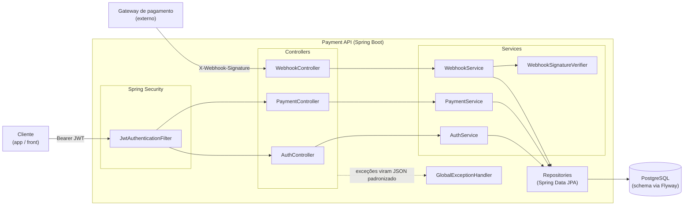
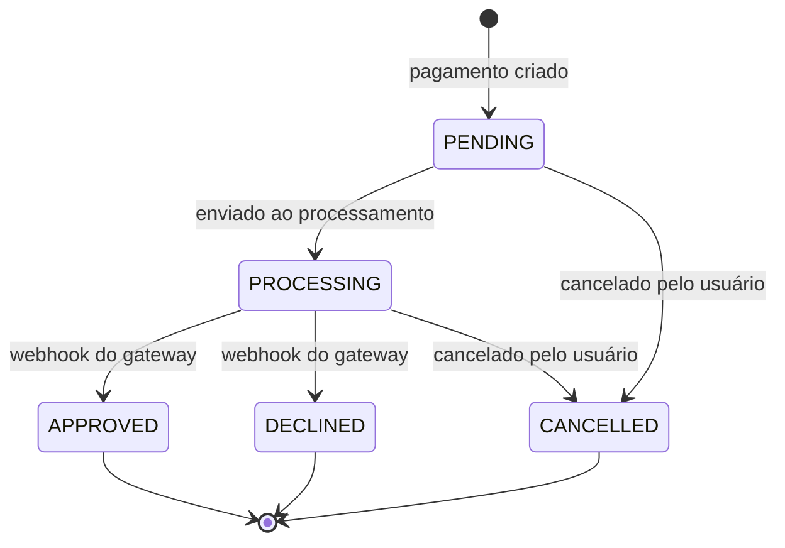
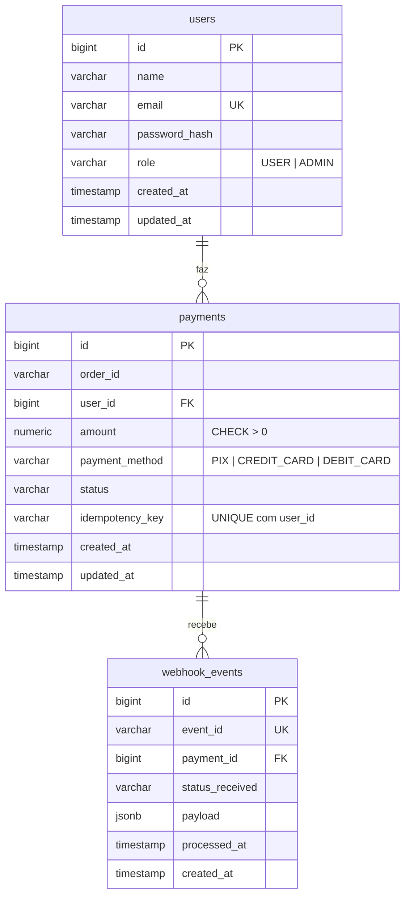

# Payment API

API REST em Java 21 + Spring Boot 4 que simula o processamento de pagamentos de pedidos. O foco não é o CRUD em si, e sim os problemas que todo sistema de pagamento real precisa resolver: **requisições duplicadas, transições de estado inválidas, eventos externos não confiáveis e acesso a dados de outros usuários.**

**Stack:** Java 21 · Spring Boot 4.1 · Spring Security + JWT · Spring Data JPA · PostgreSQL 16 · Flyway · Bean Validation · springdoc-openapi (Swagger) · JUnit 5 · Mockito · Testcontainers · Docker Compose

## Destaques técnicos

- **Idempotência sob concorrência real** — o header `Idempotency-Key` impede pagamento duplicado mesmo com requisições idênticas chegando ao mesmo tempo. Testado disparando requisições simultâneas contra um Postgres real.
- **Máquina de estados no domínio** — a própria entidade `Payment` recusa transições inválidas (ex.: cancelar um pagamento já aprovado), em vez de espalhar `if`s pelos services.
- **Webhook com assinatura HMAC-SHA256** — só o gateway que conhece o segredo consegue mudar o status de um pagamento. Comparação em tempo constante contra timing attack.
- **Webhook idempotente** — o mesmo evento entregue duas vezes (o que gateways reais fazem) é processado uma única vez.
- **Autorização por escopo de dados** — USER só enxerga os próprios pagamentos, ADMIN enxerga todos. Pagamento de outro usuário responde 404, não 403.
- **92 testes automatizados** — 54 unitários (domínio, validação e services com Mockito) + 38 de integração com Postgres real em container (Testcontainers), incluindo a camada HTTP inteira via MockMvc.

---

## Arquitetura

Arquitetura em camadas clássica do Spring. Cada camada só conversa com a de baixo.



| Pacote | Responsabilidade |
|---|---|
| `controller` | Recebe HTTP, valida entrada (`@Valid`), devolve DTO. Sem regra de negócio. |
| `service` | Regras de negócio, transações, idempotência, escopo USER/ADMIN. |
| `entity` | Entidades JPA. `Payment` contém a máquina de estados. |
| `repository` | Interfaces Spring Data JPA. |
| `dto` | Records de entrada e saída — a entidade nunca é exposta direto na API. |
| `security` | Filtro JWT, configuração do Spring Security, verificação HMAC. |
| `exception` | Exceções de domínio + `@RestControllerAdvice` que as converte em respostas JSON. |
| `config` | Configuração do OpenAPI/Swagger. |

### Máquina de estados do pagamento



Na criação, o pagamento é gravado como `PENDING` e passa para `PROCESSING` na mesma transação. `APPROVED`, `DECLINED` e `CANCELLED` são terminais. Qualquer outra transição lança `InvalidPaymentStateException` → **409 Conflict**.

### Idempotência com requisições simultâneas

O cenário difícil não é o reenvio *depois* da primeira resposta — é duas requisições com a mesma chave chegando **ao mesmo tempo**, ambas passando pela checagem "essa chave já existe?" antes de qualquer uma gravar.

```mermaid
sequenceDiagram
    participant A as Requisição A
    participant B as Requisição B
    participant S as PaymentService
    participant DB as PostgreSQL

    A->>S: POST /payments (user=u1, key=abc)
    B->>S: POST /payments (user=u1, key=abc)
    S->>DB: findByUserIdAndIdempotencyKey(u1, abc) — A
    DB-->>S: vazio
    S->>DB: findByUserIdAndIdempotencyKey(u1, abc) — B
    DB-->>S: vazio
    S->>DB: INSERT (A)
    DB-->>S: OK
    S->>DB: INSERT (B)
    DB-->>S: viola UNIQUE(user_id, idempotency_key)
    Note over S: a transação de B já foi revertida;<br/>busca de novo numa transação limpa
    S->>DB: findByUserIdAndIdempotencyKey(u1, abc) — B
    DB-->>S: pagamento criado por A
    S-->>A: 201 (pagamento)
    S-->>B: 201 (mesmo pagamento)
```

A checagem no código é a otimização do caso comum; a constraint `UNIQUE` no banco é a garantia real. Se a mesma chave chegar com **dados diferentes** (outro valor, outro pedido), a resposta é **409** — devolver o pagamento antigo silenciosamente esconderia um bug do cliente.

A chave é única **por usuário** (`UNIQUE(user_id, idempotency_key)`), no mesmo modelo do Stripe: idempotência é um contrato entre um cliente e a API. Com uma chave global, um usuário que reusasse a chave de outro (com o mesmo corpo) receberia o pagamento dele — um vazamento de dados entre usuários, corrigido na migration `V4`.

### Modelo de dados



O schema é versionado com Flyway (`src/main/resources/db/migration`) e o Hibernate roda com `ddl-auto: validate` — ele confere se as entidades batem com o banco, mas nunca altera o schema sozinho. As regras críticas (valor positivo, enums válidos, chaves únicas) existem **também** como constraints no banco, não só no Java.

---

## Como rodar

### Com Docker (recomendado)

Pré-requisito: Docker com Docker Compose.

```bash
git clone https://github.com/Dev-lleonardo/Payment-API.git
cd Payment-API
docker compose up --build
```

Sobe o Postgres e a aplicação. O Flyway cria as tabelas na primeira subida.

- API: http://localhost:8080
- Swagger UI: http://localhost:8080/swagger-ui.html
- Especificação OpenAPI (JSON): http://localhost:8080/v3/api-docs

Para parar: `docker compose down` (adicione `-v` para apagar também os dados do banco).

### Localmente (sem containerizar a aplicação)

Pré-requisitos: JDK 21 e Docker (só para o banco).

```bash
docker compose up -d postgres
./mvnw spring-boot:run
```

### Variáveis de ambiente

Todas têm um default para desenvolvimento local, definido em `application.yml`.

| Variável | Default | Descrição |
|---|---|---|
| `DB_HOST` / `DB_PORT` / `DB_NAME` | `localhost` / `5432` / `payment_api` | Conexão com o Postgres |
| `DB_USERNAME` / `DB_PASSWORD` | `postgres` / `postgres` | Credenciais do banco |
| `JWT_SECRET` | chave de desenvolvimento | Chave HMAC usada para assinar os tokens (mínimo 256 bits) |
| `JWT_EXPIRATION_MS` | `3600000` (1h) | Validade do token |
| `WEBHOOK_SECRET` | segredo de desenvolvimento | Segredo compartilhado com o gateway para validar o HMAC |

> ⚠️ Os defaults de `JWT_SECRET` e `WEBHOOK_SECRET` existem só para o projeto rodar com um comando. Em qualquer ambiente real eles viriam de um secret manager.

---

## Endpoints

A documentação interativa completa (com schemas, códigos de erro e botão **Authorize** para o JWT) está no Swagger UI.

| Método | Rota | Auth | Descrição |
|---|---|---|---|
| `POST` | `/auth/register` | — | Cadastra usuário (sempre com role USER) |
| `POST` | `/auth/login` | — | Devolve um token JWT |
| `POST` | `/payments` | JWT | Cria pagamento. Exige header `Idempotency-Key` |
| `GET` | `/payments` | JWT | Lista paginada (`?page=0&size=20&sort=amount,desc`) |
| `GET` | `/payments/{id}` | JWT | Consulta um pagamento |
| `POST` | `/payments/{id}/cancel` | JWT | Cancela (só `PENDING` ou `PROCESSING`) |
| `POST` | `/webhooks/payment` | HMAC | Evento do gateway: `PROCESSING` → `APPROVED`/`DECLINED` |

Todos os erros seguem o mesmo formato:

```json
{
  "timestamp": "2026-10-16T21:18:43.760232866",
  "status": 409,
  "error": "Conflict",
  "message": "Cannot cancel a payment with status CANCELLED; only PENDING or PROCESSING payments can be cancelled",
  "path": "/payments/55/cancel"
}
```

### Fluxo completo pelo terminal

```bash
# 1. Cadastro
curl -X POST http://localhost:8080/auth/register \
  -H "Content-Type: application/json" \
  -d '{"name":"Ana","email":"ana@email.com","password":"senha12345"}'

# 2. Login — guarda o token
TOKEN=$(curl -s -X POST http://localhost:8080/auth/login \
  -H "Content-Type: application/json" \
  -d '{"email":"ana@email.com","password":"senha12345"}' | sed -E 's/.*"token":"([^"]+)".*/\1/')

# 3. Cria um pagamento (rode duas vezes: a segunda devolve o MESMO pagamento)
curl -X POST http://localhost:8080/payments \
  -H "Authorization: Bearer $TOKEN" \
  -H "Content-Type: application/json" \
  -H "Idempotency-Key: pedido-123-tentativa-1" \
  -d '{"orderId":"pedido-123","amount":150.00,"paymentMethod":"PIX"}'

# 4. Simula o gateway aprovando o pagamento (troque o paymentId pelo id retornado acima)
SECRET=67810b93bde1dbed157c62e6ab28a7b281f813cf6f8d5347d9bac7e7be45ab97
BODY='{"paymentId":1,"status":"APPROVED","eventId":"evt-001"}'
SIGNATURE=$(printf '%s' "$BODY" | openssl dgst -sha256 -hmac "$SECRET" | sed 's/^.* //')
curl -X POST http://localhost:8080/webhooks/payment \
  -H "Content-Type: application/json" \
  -H "X-Webhook-Signature: $SIGNATURE" \
  -d "$BODY"
```

> Não existe endpoint para criar ADMIN — isso é proposital (ninguém deveria conseguir se autopromover pela API pública). Para testar o escopo de ADMIN localmente: `docker exec -it payment-api-postgres psql -U postgres -d payment_api -c "UPDATE users SET role='ADMIN' WHERE email='ana@email.com';"` e faça login de novo (a role vai dentro do token).

---

## Testes

```bash
./mvnw verify   # unitários (Surefire) + integração (Failsafe)
./mvnw test     # só a fase de testes do Surefire
```

Os testes de integração usam **Testcontainers**: sobem um PostgreSQL 16 real em container durante o build. Só é preciso ter o Docker rodando — o `docker-compose.yml` não é usado nos testes.

| Classe | Tipo | Testes | O que cobre |
|---|---|---|---|
| `PaymentTest` | Unitário | 21 | Todas as transições válidas e inválidas da máquina de estados |
| `PaymentRequestValidationTest` | Unitário | 6 | Regras do Bean Validation no DTO de entrada |
| `PaymentServiceTest` | Unitário (Mockito) | 14 | Idempotência, conflito de chave, escopo USER/ADMIN |
| `WebhookServiceTest` | Unitário (Mockito) | 13 | Assinatura, payload inválido, evento repetido, ordem das checagens |
| `PaymentIdempotencyConcurrencyTest` | Integração | 1 | Várias threads com a mesma chave ao mesmo tempo → exatamente 1 pagamento |
| `PaymentApiApplicationTests` | Integração | 1 | Contexto Spring sobe com migrations aplicadas |
| `AuthControllerIT` | Integração HTTP | 9 | Registro e login pela camada HTTP inteira |
| `PaymentControllerIT` | Integração HTTP | 16 | CRUD, idempotência, escopo, transições inválidas, 401 sem token |
| `WebhookControllerIT` | Integração HTTP | 10 | HMAC válido/inválido, processamento, idempotência por `eventId` |

Os testes de integração reaproveitam **um único container** para a suíte inteira (Singleton Container, em `AbstractIntegrationTest`), em vez de subir um Postgres por classe.

---

## Decisões técnicas

**Pagamento de outro usuário responde 404, não 403.**
403 confirmaria que aquele id existe e pertence a outra pessoa — vazamento de informação que permite enumerar pagamentos. Para quem não tem acesso, o recurso simplesmente não existe.

**O webhook recebe o corpo como `String` crua, não como DTO.**
O HMAC é calculado sobre os bytes exatos que o gateway enviou. Se o Spring desserializasse direto para um objeto, a formatação original (espaços, ordem dos campos) se perderia e a assinatura recalculada nunca bateria. A ordem é: valida assinatura → desserializa → valida campos.

**No webhook, a idempotência é checada *antes* de mudar o pagamento.**
Diferente da criação de pagamento (onde o próprio `INSERT` é a operação idempotente), no webhook a mudança de status acontece antes de gravar o evento. Se o mesmo evento chegasse de novo sem a checagem prévia, o pagamento já estaria `APPROVED` e a transição falharia com 409 — para uma reentrega legítima. Por isso: `findByEventId` primeiro, e a constraint `UNIQUE(event_id)` como rede de segurança para concorrência.

**Self-injection com `@Lazy` para separar transações.**
Quando um `INSERT` viola uma constraint, o Hibernate invalida a sessão inteira — não dá para "tentar de novo" dentro da mesma transação. A recuperação precisa de uma transação nova. Mas chamar `this.metodoTransacional()` não passa pelo proxy do Spring, e o `@Transactional` é ignorado silenciosamente. A solução foi injetar o proxy do próprio bean (`self`, com `@Lazy` para evitar dependência circular) e chamar `self.insertAndStartProcessing(...)`.

**JWT stateless, sem consultar o banco a cada requisição.**
O filtro lê o id do usuário (`sub`) e a role direto do token assinado. Isso evita uma query por requisição. O custo: se a role de alguém mudar, só vale depois que o token atual expirar (1h). Em produção, isso se resolve com tokens de vida curta + refresh token.

**Regras de negócio duplicadas no banco de propósito.**
`amount > 0`, enums válidos e chaves únicas são validados no Java *e* existem como `CHECK`/`UNIQUE` no Postgres. O Java dá a mensagem de erro amigável; o banco garante a integridade mesmo se alguém escrever direto nele ou se um bug passar pela validação.

---

## Desafios e lições aprendidas

- **Spring Boot 4 trouxe Jackson 3.** O bean disponível para injeção passou a ser `tools.jackson.databind.json.JsonMapper`, não mais o `com.fasterxml...ObjectMapper` que aparece na maioria dos tutoriais.
- **Pacotes de teste modularizados no Boot 4.** Não só as dependências mudaram — os pacotes das anotações também. `@AutoConfigureMockMvc` saiu de `org.springframework.boot.test.autoconfigure.*` para `org.springframework.boot.webmvc.test.autoconfigure.*`.
- **Sessão do Hibernate corrompida após violação de constraint.** A primeira versão da idempotência fazia insert + `catch` + nova busca no mesmo método `@Transactional` e falhava com "session is flushed after an exception occurs". Isso levou à separação de transações descrita acima.
- **Bytecode desatualizado por causa do OneDrive.** O projeto começou numa pasta sincronizada; o `.java` estava correto no disco mas o `.class` compilado não. Desde então o projeto vive fora de qualquer pasta com sincronização em nuvem.
- **A maior parte dos bugs da fase de testes foi de ferramenta, não de regra de negócio:** stub desnecessário no Mockito (`UnnecessaryStubbingException`), sintaxe de mock para método `void` (`doThrow().when()`), imports que mudaram de pacote entre versões. Escrever teste bem exige acompanhar a ferramenta, não só entender o domínio.

---

## O que eu faria em um sistema em produção

Fora do escopo deste projeto de propósito, mas seriam os próximos passos num sistema real:

- **Integração real com gateway** — hoje a transição para `PROCESSING` é simulada. Num sistema real, a chamada ao gateway sairia por um **outbox pattern** (gravar a intenção na mesma transação e publicar de forma assíncrona) para não perder nem duplicar chamadas se a aplicação cair no meio.
- **Refresh token e revogação** — tokens de acesso curtos (minutos) + refresh token, permitindo deslogar e mudar role sem esperar expirar.
- **Rate limiting** — principalmente em `/auth/login` (força bruta) e `/payments`.
- **Observabilidade** — Actuator com health check, métricas (Micrometer/Prometheus) e logs estruturados com um id de correlação por requisição.
- **Segredos fora do código** — remover os defaults de `JWT_SECRET`/`WEBHOOK_SECRET` e exigir que venham de um secret manager; desligar o Swagger UI em produção.
- **Expiração de `Idempotency-Key`** — hoje a chave vale para sempre; o padrão de mercado é expirar depois de ~24h.

---

Desenvolvido como projeto de portfólio, fase a fase, com foco em entender e conseguir defender cada decisão técnica — não só em ter o código funcionando.
